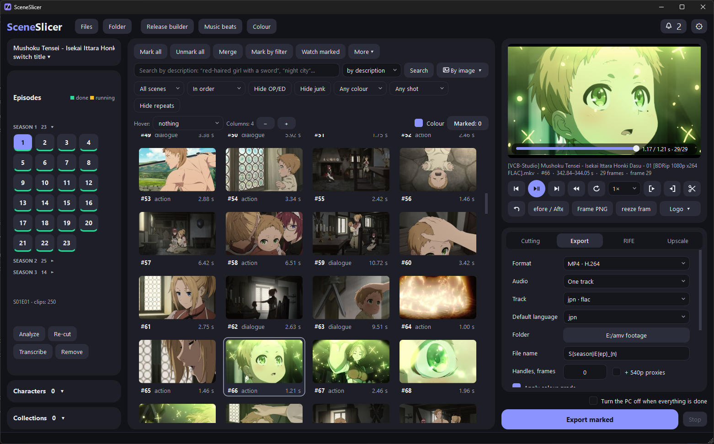
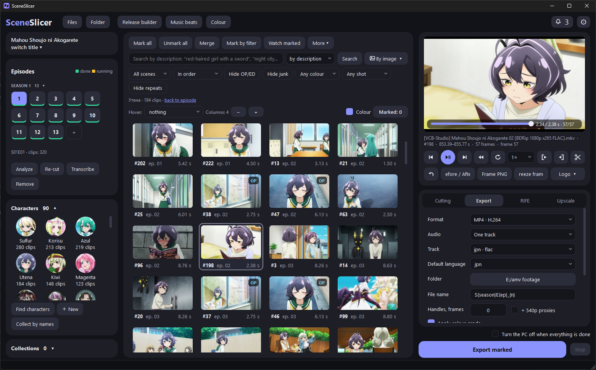
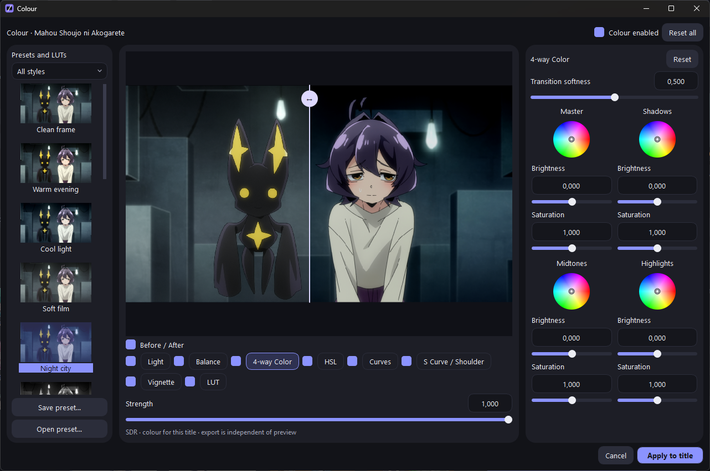
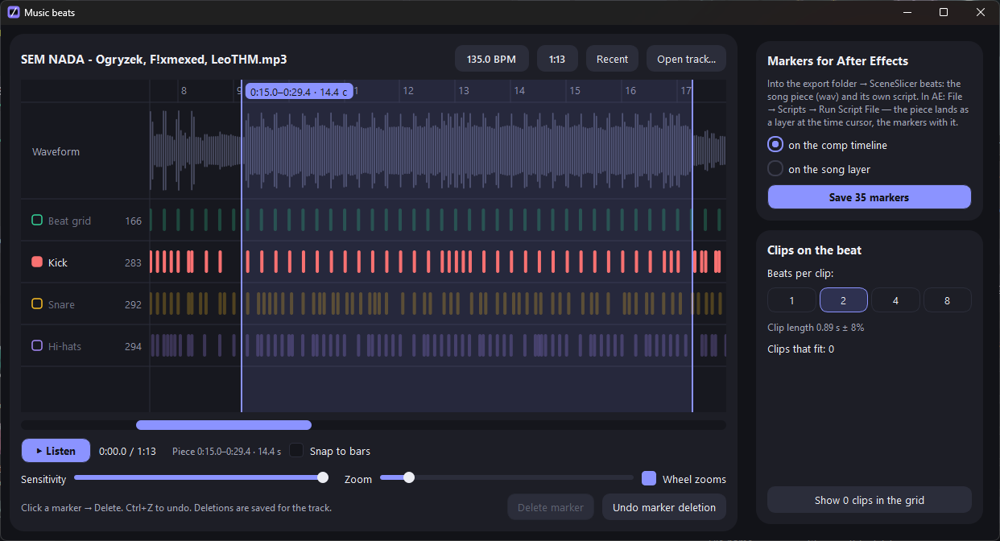
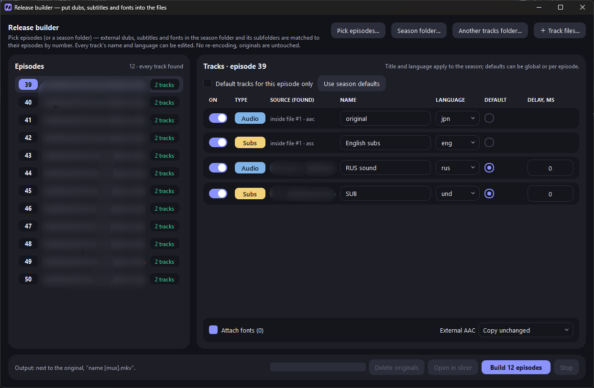
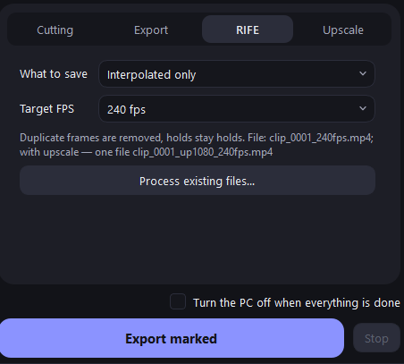
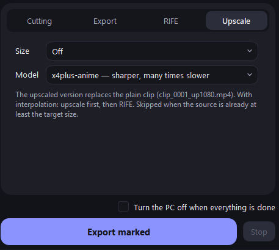
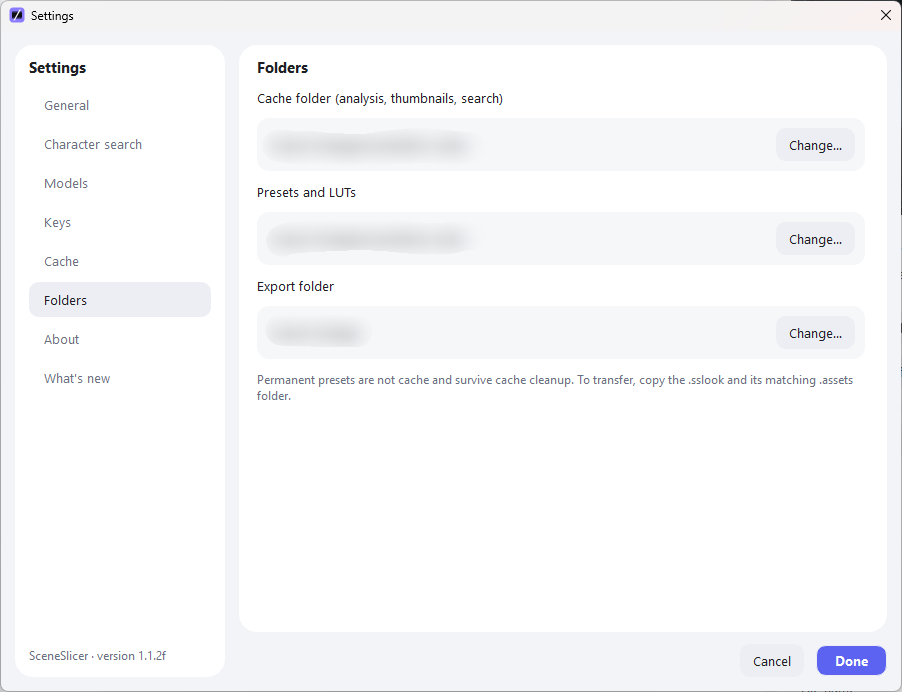
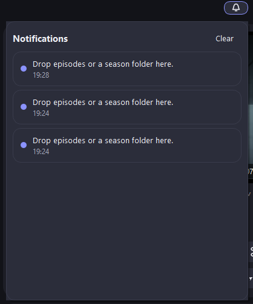

# SceneSlicer

**Find a scene. Prepare a clip. Bring it into your edit.**

> The first release is being prepared. The description and screenshots are available now; installation packages have not been published yet. The first public release will already include in-app updates.

[Русский](README.md) · [Download for Windows](https://github.com/gogoigor51-tech/SceneSlicer/releases/latest) · [Report an issue](https://github.com/gogoigor51-tech/SceneSlicer/issues/new/choose)

SceneSlicer is a free desktop tool for finding, cutting and preparing video scenes for AMVs and edits. Episodes, characters, collections, colour grading and export share one workspace. No Python installation is required.

## From episode to edit

1. Add a video or a season folder. A title can contain multiple seasons.
2. Analyze the video to detect scenes. Find clips by character, image, description or dialogue.
3. Adjust boundaries and mark clips. Apply colour grading, upscaling or interpolation when needed.
4. Export your clips or drag a prepared clip into your editing application.

## Features

| Workflow | Available tools |
| --- | --- |
| Library | Titles, seasons, episodes, collections and saved workspace state |
| Search | Description, image, dialogue, similar clips, character detection and manual organization |
| Selection | Checkboxes, Shift ranges, Ctrl toggles, OP/ED and duplicate filters |
| Editing | Frame stepping, seeking, In/Out, split, merge and undo |
| Colour | Presets, exposure, balance, four-way wheels, HSL, curves, vignette, LUTs and a before/after wipe |
| Export | Format and audio options, queue, RIFE, Real-ESRGAN and independent colour export |
| NLE workflow | Clip dragging, After Effects scripts, 540p proxies and Premiere draft XML |
| Music | Track ranges, beat detection, manual marker deletion and After Effects export |
| Release builder | External dubs, subtitles and fonts; season defaults and episode overrides |
| Interface | English/Russian, dark/light themes, notification history, cache and folder management |

## Interface tour

### Characters belong to their title

Name groups, correct results and assign a clip to multiple characters. Automatic detection can make mistakes; assignments can be edited manually.

### Colour grading with a before/after wipe

Grades are saved per title. Preview and colour export have independent switches. Custom presets and LUTs use a permanent folder.

### Beats for the section you need

Select a track range, choose marker types and remove unwanted markers. Export includes the selected audio as WAV and a separate After Effects script for composition or audio-layer markers.

### Release builder

Combine episodes with external audio, delays, subtitles and fonts. Results are saved separately. Override season defaults for individual episodes.

| RIFE interpolation | Real-ESRGAN upscaling |
| --- | --- |
|  |  |

### Light theme and permanent folders

Notification history

## Installation

1. Open the [latest release](https://github.com/gogoigor51-tech/SceneSlicer/releases/latest) and download the Windows x64 package from Assets.
2. Extract the entire archive into a writable folder. Keep its subfolders beside the executable.
3. Run `SceneSlicer.exe`. The first public release includes in-app checking and installation of subsequent updates.
4. Set export, cache and preset folders in Settings. Additional models download when needed.

Tested on Windows 11 x64. RIFE and upscaling require a compatible GPU and Vulkan driver. Analysis and processing performance depend on hardware and selected models.

## Updates and feedback

The app offers available updates with release notes. Update now or ask it to remind you later. Installation waits for active tasks, preserves settings and retains the previous build for rollback.

Use Bug report in Settings to describe reproduction steps, expected behaviour and the actual result. Choose screenshots and open a prepared GitHub issue, review its text and attach the images before submitting. A GitHub account is required. The author's email address is not embedded in the app.

## About

The public edition is free. Application source code is not published at this time. Third-party licences are listed in About and included in the distribution's `licenses` folder; their terms remain applicable independently of the application.

Release notes are available in [CHANGELOG](CHANGELOG.md) and in the app. This repository contains documentation and public SceneSlicer releases.
