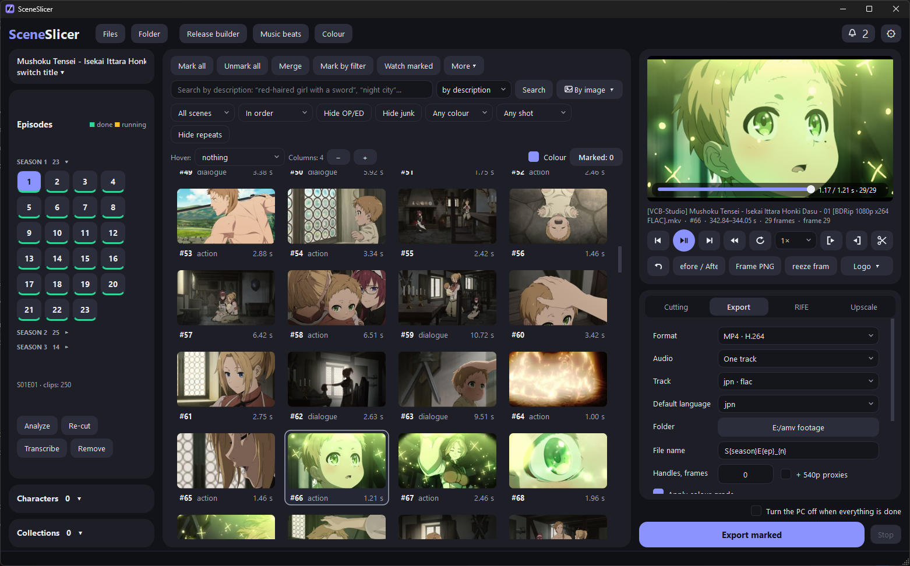
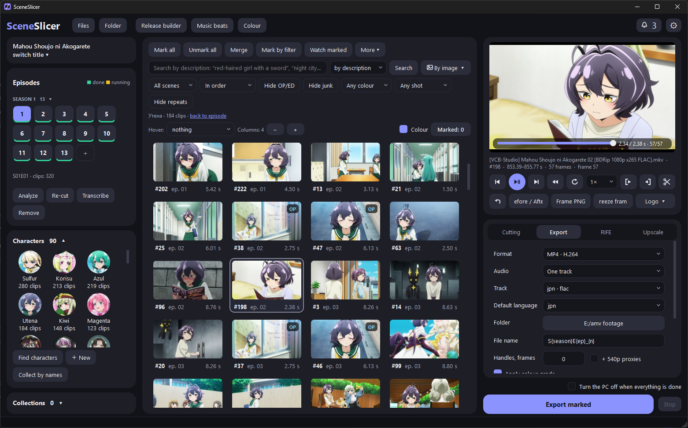
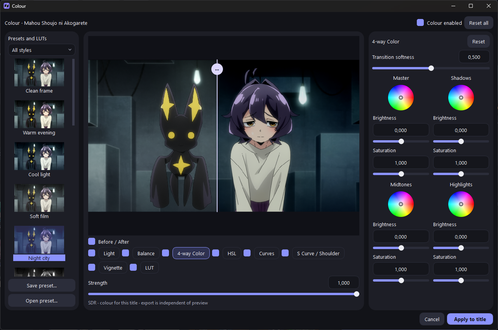
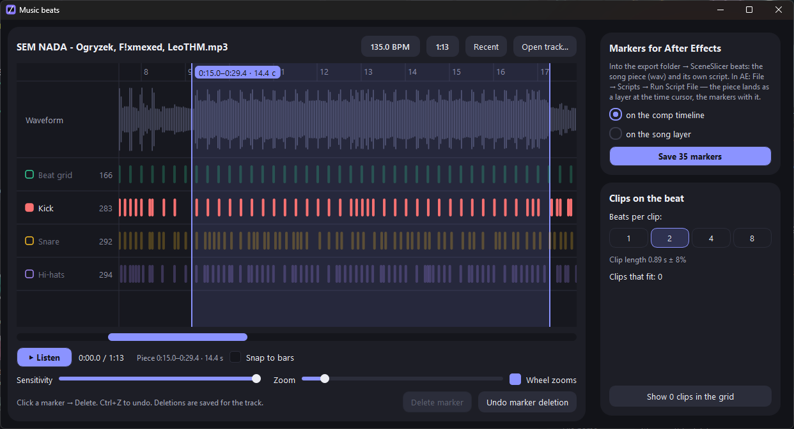
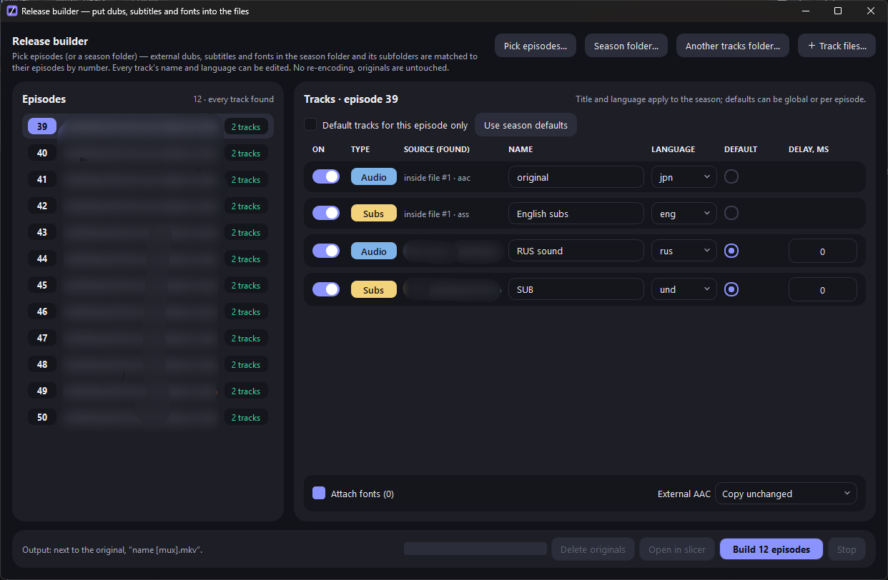
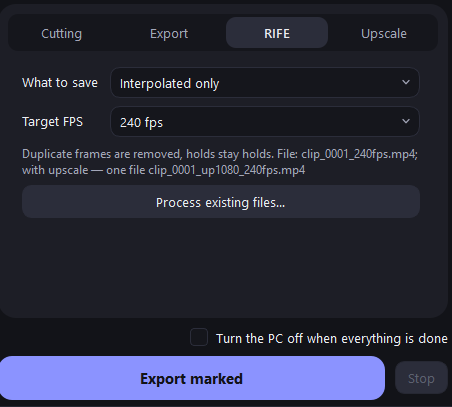
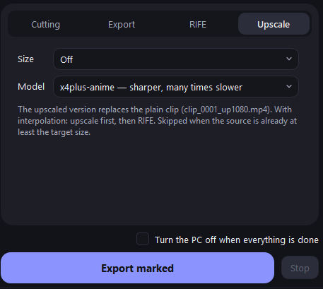
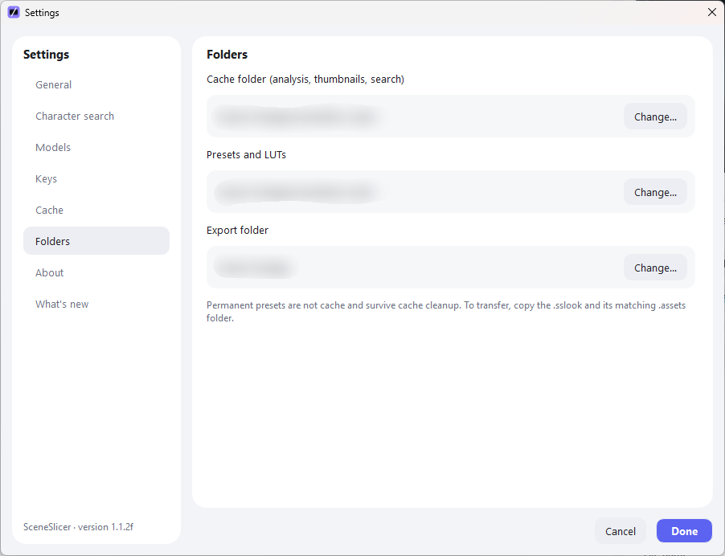
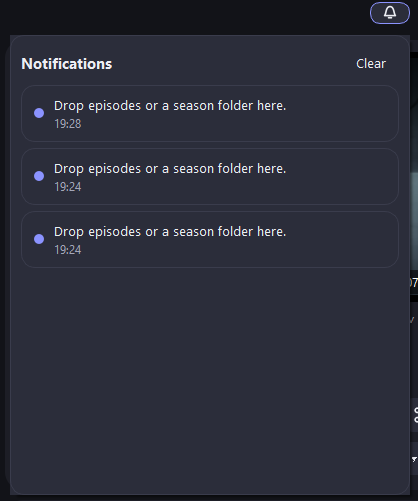

# SceneSlicer

**Найти сцену. Подготовить клип. Перенести в монтаж.**

> Первый выпуск готовится. Пока здесь доступны описание и скриншоты; установочные пакеты ещё не опубликованы. Первый публичный выпуск уже будет включать автообновление.

[English](README.en.md) · [Скачать для Windows](https://github.com/gogoigor51-tech/SceneSlicer/releases/latest) · [Сообщить о проблеме](https://github.com/gogoigor51-tech/SceneSlicer/issues/new/choose)

SceneSlicer — бесплатная программа для поиска и нарезки сцен, подготовки AMV и эдитов. Серии, персонажи, коллекции, цветокоррекция и экспорт собраны в одном рабочем окне. Python устанавливать не требуется.

## От серии до готового клипа

1. Добавьте видео или папку сезона. Несколько сезонов можно хранить внутри одного тайтла.
2. Запустите анализ: программа разделит видео на сцены. Найдите нужное по персонажу, изображению, описанию или реплике.
3. Уточните границы, отметьте клипы, при желании примените цветокоррекцию, апскейл и интерполяцию.
4. Экспортируйте результат или перетащите подготовленный клип в монтажную программу.

## Возможности

| Работа | Что есть в программе |
| --- | --- |
| Библиотека | Тайтлы, сезоны, серии, коллекции, сохранение рабочего состояния |
| Поиск | Описание, картинка, реплика, похожие клипы, поиск и ручная организация персонажей |
| Отбор | Галочки, диапазон Shift, переключение Ctrl, фильтры OP/ED, повторов и других сцен |
| Подготовка | Покадровый просмотр, перемотка, In/Out, разрезание, склейка и отмена правок |
| Цвет | Пресеты, свет, баланс, четыре цветовых колеса, HSL, кривые, виньетка и LUT; шторка до/после |
| Экспорт | Выбор формата и звука, очередь, RIFE, Real-ESRGAN, отдельное включение цветокоррекции |
| Монтаж | Перетаскивание клипов, скрипты After Effects, прокси 540p, черновой XML для Premiere |
| Музыка | Выбор участка трека, детектирование ударов, удаление лишних маркеров и экспорт в After Effects |
| Сборка релиза | Внешние озвучки, субтитры и шрифты; настройки сезона и отдельной серии |
| Удобство | Русский и английский, тёмная и светлая темы, история уведомлений, управление кешем и папками |

## Знакомство с интерфейсом

### Персонажи внутри тайтла

Имена, ручные исправления и добавление клипа нескольким персонажам помогают привести результаты поиска в порядок. Автоматический поиск может ошибаться — результаты можно корректировать.

### Цветокоррекция с просмотром до/после

Настройка сохраняется для тайтла. Просмотр цвета и экспорт с цветом включаются отдельно; собственные пресеты и LUT хранятся в постоянной папке.

### Биты для выбранного участка музыки

Выделите нужный фрагмент, выберите типы маркеров и уберите лишние вручную. Экспорт включает WAV выбранного участка и отдельный скрипт After Effects для маркеров на композиции или аудиослое.

### Сборка релиза

Соберите видео с нужными внешними дорожками, задержками, субтитрами и шрифтами. Результат сохраняется отдельно; общие настройки можно переопределить для конкретной серии.

### RIFE и апскейл

| Интерполяция | Апскейл |
| --- | --- |
|  |  |

### Светлая тема, папки и уведомления

История уведомлений

## Установка

1. Откройте [последний выпуск](https://github.com/gogoigor51-tech/SceneSlicer/releases/latest) и скачайте пакет Windows x64 из списка Assets.
2. Полностью распакуйте архив в отдельную папку с правом записи. Сохраните все вложенные папки рядом с exe.
3. Запустите `SceneSlicer.exe`. Первый публичный выпуск включает проверку и установку следующих обновлений из программы.
4. Укажите папки экспорта, кеша и пресетов в настройках. Дополнительные модели скачиваются по мере необходимости.

Проверено на Windows 11 x64. Для RIFE и апскейла требуется совместимая видеокарта с рабочим драйвером Vulkan. Тяжёлые функции и скорость анализа зависят от оборудования и используемых моделей.

## Обновления и помощь

Программа предлагает доступное обновление и показывает изменения. Можно обновить её или напомнить позже. Установка ждёт завершения задач, сохраняет настройки и оставляет предыдущую сборку для отката.

В настройках есть Bug report: опишите шаги, ожидаемый результат и то, что получилось. Подготовьте скриншоты и откройте обращение на GitHub; перед отправкой проверьте текст и прикрепите изображения. Для отправки нужен GitHub-аккаунт. Адрес электронной почты автора в программу не встроен.

## О проекте

Публичная версия бесплатна; исходники самого приложения пока не публикуются. Лицензии сторонних компонентов доступны в настройках «О программе» и папке `licenses` дистрибутива. Условия сторонних компонентов сохраняются независимо от условий приложения.

Изменения перечислены в [CHANGELOG](CHANGELOG.md) и внутри программы. Этот репозиторий содержит документацию и публичные выпуски SceneSlicer.
